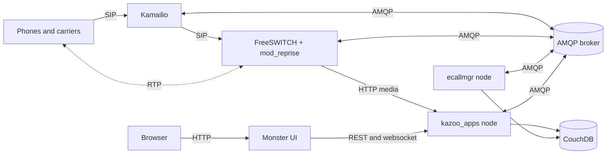

# Reprise

Reprise is an open source, multi-tenant telephony platform. It is a fork of
[Kazoo](https://github.com/2600hz/kazoo5) 5.4, maintained by Vonix LLC.

A Reprise cluster is Kamailio at the SIP edge, FreeSWITCH for media, and a
set of Erlang applications that route calls, keep accounts and devices in
CouchDB, and serve the Kazoo REST and websocket APIs. The parts talk to each
other over an AMQP broker. [Monster UI](https://github.com/reprise-voice/monster-ui)
is the web interface.

It is for operators who run, or want to run, a Kazoo 5.x style platform
without the closed components a 2600Hz deployment depended on, and for
developers who build on the Kazoo APIs. 2600Hz no longer maintains upstream
Kazoo. Every source repository this build needs is kept under
[github.com/reprise-voice](https://github.com/reprise-voice).

The Erlang application names, node names, `sup` commands and `/etc/kazoo`
paths keep their Kazoo names, so APIs, configurations and user interfaces
written for Kazoo keep working. "Reprise" names the project, the repository,
the releases and the container images.

- [What it does](#what-it-does)
- [How it fits together](#how-it-fits-together)
- [Try it: a test cluster with Docker Compose](#try-it-a-test-cluster-with-docker-compose)
- [Set up a development environment](#set-up-a-development-environment)
- [Repository layout](#repository-layout)
- [What is different from Kazoo 5.4](#what-is-different-from-kazoo-54)
- [Container images](#container-images)
- [Documentation](#documentation)
- [Contributing](#contributing)
- [Status and compatibility](#status-and-compatibility)
- [License](#license)

## What it does

- Accounts, sub-accounts, users and devices, each account with its own SIP
  realm.
- Callflows: per-account call routing built from devices, users, ring
  groups, menus, voicemail, time-of-day rules and more.
- Voicemail, conferences, fax (including email to fax), call recording and
  music on hold.
- Call center queues and agents, in-call feature codes (transfer, record)
  and SIP trunking for PBXes.
- Carrier routing for outbound calls, number management, per-account call
  limits and call detail records.
- STIR/SHAKEN signing and verification.
- A REST API, a websocket event API, webhooks, and call control handed to
  your own HTTP server (Pivot).

Some of these are off until you start their application; the
[application table](doc/architecture.md#the-applications) says which run by
default.

## How it fits together



| Component | What it does |
|---|---|
| Kamailio | The SIP edge. Phones register here, and it keeps their locations. It checks their credentials against Kazoo, handles NAT, TLS and websockets, tracks presence, and spreads calls across the FreeSWITCH servers. |
| FreeSWITCH with `mod_reprise` | The media server: RTP to and from phones, conferences, fax, recording and prompts. `mod_reprise` connects it to the broker. Through it FreeSWITCH fetches its configuration and dialplan, publishes call events and receives commands. |
| AMQP broker | The bus everything else talks over. RabbitMQ and LavinMQ both work. |
| ecallmgr node | An Erlang node running `ecallmgr`, which controls the FreeSWITCH servers and tracks their channels, and `ecallmgr_extension`, the Kazoo end of the `mod_reprise` transport. |
| kazoo_apps node | An Erlang node running the applications: `crossbar` (REST API), `blackhole` (websocket API), `callflow`, `registrar`, `stepswitch` (carrier routing), `media_mgr`, `cdr`, `teletype` (email notifications) and the rest. A cluster can run several, each with its own list of applications. |
| CouchDB | All stored data: accounts, devices, callflows, voicemail, media, call records and system configuration. |
| Monster UI | The web interface. nginx serves it and proxies the REST and websocket APIs. |

Both Erlang node types run from one release and one image. The node name
and its application list decide what a node does. Apart from CouchDB and the
web interface, no component connects to another directly: FreeSWITCH has no
Erlang link to ecallmgr, and Kamailio has no link to the Erlang nodes. The
Erlang nodes also reach each other through the broker, not over TCP
distribution.

### A registration

1. A phone sends REGISTER to Kamailio, which answers with a digest
   challenge.
2. The phone repeats the request with credentials. Kamailio asks Kazoo for
   the device over the broker, and the `registrar` application answers from
   the account's database.
3. Kamailio checks the digest, stores the phone's contact in its own
   location table, replies 200 and publishes the registration. `ecallmgr`
   caches it for the rest of the platform.

### A call between two registered phones

1. The caller's phone sends INVITE to Kamailio. Kamailio recognises the
   phone by its registration, adds the device's authorization token and
   passes the call to a FreeSWITCH server. A caller it does not recognise
   is challenged first.
2. FreeSWITCH takes the call because it comes from a Kamailio it trusts
   (ecallmgr serves it that list) and carries the token.
3. FreeSWITCH asks for a dialplan. `mod_reprise` sends the question over
   the broker to `ecallmgr_extension`, which publishes a route request.
4. `callflow` answers that it can route the call, wins it, and runs the
   account's callflow for the dialled number. Each step is a command that
   ecallmgr sends back to FreeSWITCH: play, record, bridge.
5. To ring the other phone, FreeSWITCH sends an INVITE to Kamailio, which
   looks up the registered contact and forwards it.
6. Audio flows between each phone and FreeSWITCH. Prompts and voicemail
   come from `media_mgr` over HTTP.
7. When the call ends, FreeSWITCH publishes its record and `cdr` stores it
   in CouchDB.

[doc/architecture.md](doc/architecture.md) goes further: every application,
the exchanges involved, Erlang distribution over AMQP, and zones.

## Try it: a test cluster with Docker Compose

`deploy/compose` runs a whole cluster on one machine: CouchDB, LavinMQ, both
Erlang nodes, FreeSWITCH, Kamailio and Monster UI. It is for testing and
evaluation. There is one of everything, nothing uses TLS and the credentials
are examples, so do not put it on a network you do not trust.

You need Docker Engine 25 or later with the Compose plugin 2.24 or later, a
linux/amd64 machine, about 4 GB of free memory, and the host's ports 5060,
8080 and 16384-16483/udp free.

```bash
cd deploy/compose
./init-env.sh            # writes .env: this machine's address and new credentials
docker compose up -d
./bootstrap.sh
```

`init-env.sh` writes `.env` with the machine's LAN address as `HOST_IP`
(pass another address as its argument) and a random admin password, CouchDB
password and Erlang cookie. Nothing in the repository is a usable
credential, and the cluster does not start without them.

The first start pulls the images and creates the databases, which takes a
few minutes. `bootstrap.sh` waits for the nodes, creates the first account
and its admin user from `.env`, imports the system prompts, registers the
Monster UI apps and lets FreeSWITCH accept calls from Kamailio. It prints
the address to log in at and is safe to run again. The login is
`ADMIN_USER` and `ADMIN_PASSWORD` in `.env`.

Then either:

- open `http://HOST_IP:8080`, create two devices with extensions, and
  register two softphones against `HOST_IP:5060`; or
- run `./smoke/smoke.sh`, which creates two devices through the API,
  registers both with SIPp and places a call between them. This is the
  check CI runs. It needs `sipp`, `jq` and `curl`.

Run softphones on other machines. A phone on the Docker host that sends
from `HOST_IP` registers, but its calls are refused, because that is the
address Kamailio calls its own.

```bash
docker compose ps                    # state and health of each service
docker compose logs -f kazoo-apps    # or ecallmgr, freeswitch, kamailio
docker compose down -v               # remove everything, data included
```

[deploy/compose/README.md](deploy/compose/README.md) has the full
walkthrough, the ports, a host-network variant for Linux, and
troubleshooting.

## Set up a development environment

### Tools

| Tool | Version | Notes |
|---|---|---|
| Erlang/OTP | 28 | `.tool-versions` names the release, for asdf and similar tools. |
| GNU make | 4.x | |
| git | 2.x | |
| C toolchain | | gcc and g++, with the OpenSSL, ncurses, zlib, expat and libxslt headers. The package list in `docker/reprise/Dockerfile` is a known-good set on Debian. |
| Gleam | 1.18.1 | For `core/kazoo_gleam` and the `callcenter` and `stir` applications. Without it they are skipped. |
| Python 3 | | For some of the scripts. |
| Docker | | Only for the images, the test cluster and the FreeSWITCH module. |

### Build

```bash
git clone https://github.com/reprise-voice/reprise.git
cd reprise
make prerequisites deps   # tool checks, erlang.mk, rebar3, dependencies into deps/
make core apps            # compile core/ and applications/
make build-release        # the release, in _rel/kazoo
```

`make -C applications/<app>` rebuilds one application once `core` is built.
The dependencies come from the reprise-voice forks and from hex, always at a
pinned commit or version.

### Test

```bash
make eunit                         # all of core/ and applications/
make -C applications/callflow eunit   # one application
make gleam-check                   # format check and tests for every Gleam package
make xref                          # cross-reference check
make dialyze-changed               # dialyzer on what your branch changes (make build-plt first)
make fmt                           # format the Erlang files you changed (uses Emacs)
```

The Gleam tests run against an in-memory datastore and broker, so they need
nothing else running.

### Run what you built

The release needs a `config.ini`, a broker and CouchDB
([doc/configuration.md](doc/configuration.md)). The shortest way to a
running system is to build the images from your tree and start them with
the Compose project:

```bash
cd deploy/compose
docker compose -f compose.yaml -f compose.build.yaml build
docker compose -f compose.yaml -f compose.build.yaml up -d
./bootstrap.sh
```

This builds all four images. The first build takes an hour or more, most of
it the Erlang release and FreeSWITCH; later builds reuse the layers that
did not change.

### The FreeSWITCH module

`freeswitch/mod_reprise` builds against the patched FreeSWITCH in the
FreeSWITCH image, so its tests run in that image's build stage:

```bash
docker/build.sh freeswitch-dev
cd freeswitch/mod_reprise
docker run --rm --platform linux/amd64 -v "$PWD":/usr/src/mod_reprise \
  -w /usr/src/mod_reprise -e PKG_CONFIG_PATH=/usr/local/freeswitch/lib/pkgconfig \
  reprise/reprise-freeswitch-dev:dev make test
```

### Things that catch people out

- Keep `JOBS=1`, the default. Some applications generate source files in
  make rules that race with a parallel compile.
- A test build is not a release build. `make eunit` compiles with `-DTEST`
  into the same directories, and `make build-release` refuses to run after
  it. Run `make clean-core clean-apps core apps` first.
- A node needs a host name that resolves to a fully qualified name, or it
  fails to start with `nodistribution`.
- Without `gleam` the build succeeds and the release lacks the Gleam
  applications.

[doc/building.md](doc/building.md) covers the rest: every make target,
building from a mirror, and the image build arguments.

### Upstream history

The history starts with eight commits that hold Kazoo 5.4 exactly as 2600Hz
published it, one for the umbrella repository and one for each group of
component repositories. Each names its sources in `Upstream:` lines. The
upstream commits themselves are in
[reprise-voice/kazoo-archive](https://github.com/reprise-voice/kazoo-archive).

To make `git blame` and `git log` reach back into them, run
`scripts/graft-upstream-history.sh` in your clone. It fetches the archive
and attaches it with `git replace --graft`. The grafts are local, and
`scripts/graft-upstream-history.sh --undo` removes them.

## Repository layout

| Directory | What it is |
|---|---|
| `core/` | The Kazoo core libraries: AMQP, the data layer, documents, call control and so on. |
| `applications/` | The applications. Most are Erlang; `callcenter` and `stir` are Gleam. |
| `core/kazoo_gleam` | The Gleam bindings to Kazoo that the Gleam applications share. |
| `freeswitch/mod_reprise` | The FreeSWITCH module for the AMQP transport. |
| `configs/freeswitch`, `configs/kamailio` | The FreeSWITCH and Kamailio configurations, installed under `/etc/kazoo/`. |
| `vendor/amqp_dist` | Erlang distribution over AMQP. |
| `docker/` | The image builds and `docker/build.sh`. |
| `deploy/compose` | The Docker Compose test cluster. |
| `tools/fs-contract-probe` | A fake FreeSWITCH node that exercises the AMQP wire contract against a running `ecallmgr_extension`. |
| `make/`, `rel/`, `scripts/` | The build system (erlang.mk based), the release configuration and helper scripts. |
| `doc/` | The platform documentation. Each application and core library also has its own `doc/`. |

FreeSWITCH and Kamailio themselves are not in this tree. Their images clone
them at a pinned ref from the reprise-voice forks. Sounds and prompts come
from [reprise-voice/kazoo-sounds](https://github.com/reprise-voice/kazoo-sounds).

## What is different from Kazoo 5.4

- **An open FreeSWITCH transport.** 2600Hz's later deployments connected
  FreeSWITCH to Kazoo over AMQP through `mod_com_kazoo`, which was never
  published. `freeswitch/mod_reprise` is an open module that speaks the
  same wire contract, and `applications/ecallmgr_extension` answers it on
  the Kazoo side. The FreeSWITCH image builds FreeSWITCH v1.11.4 with the
  patches in `docker/freeswitch/patches`.
- **Erlang/OTP 28**, with the dependencies moved to versions that build on
  it.
- **Gleam applications**: `callcenter` (queues and agents) and `stir`
  (STIR/SHAKEN), on a shared binding library.
- **`konami`**, the in-call feature code engine, ported from Kazoo 4.x.
- **Kamailio** built from the
  [reprise-voice/kamailio](https://github.com/reprise-voice/kamailio) fork
  with the `kazoo` and `db_kazoo` modules. It keeps its state in an
  in-process SQLite database and needs no external database.
- **No telemetry.** The application that reported to a 2600Hz endpoint is
  removed, and no default points at a 2600Hz service.
- **Non-root images.** Every production image runs as an unprivileged user.
- **RabbitMQ or LavinMQ** as the broker.

[CHANGELOG.md](CHANGELOG.md) has the full list.

## Container images

Each image builds from this tree, with the repository root as the context:

```bash
docker/build.sh reprise freeswitch kamailio monster-ui
```

| Image | Contents |
|---|---|
| `reprise` | The Erlang release. One image runs both node types (`KAZOO_NODE=kazoo_apps` or `ecallmgr`). |
| `reprise-freeswitch` | Patched FreeSWITCH v1.11.4 with `mod_reprise` and `configs/freeswitch`. |
| `reprise-kamailio` | Kamailio from the fork with `configs/kamailio`. |
| `reprise-monster-ui` | Monster UI and its apps behind nginx, on port 8080. |

Released images are published under `ghcr.io/reprise-voice/`, for
linux/amd64 only. [doc/configuration.md](doc/configuration.md) lists the
environment variables each one reads, and [docker/README.md](docker/README.md)
covers runtime users, writable paths and what a production deployment needs
on top.

## Documentation

- [doc/README.md](doc/README.md): the index.
- [doc/architecture.md](doc/architecture.md): the components in detail and
  how a call moves through them.
- [doc/configuration.md](doc/configuration.md): `config.ini`, image
  environment variables, the first settings to change, the broker, CouchDB
  and ports.
- [doc/building.md](doc/building.md): building and testing from source.
- [doc/upgrading-from-kazoo.md](doc/upgrading-from-kazoo.md): notes for
  operators of an existing Kazoo 5.x cluster.
- Guides for [the call center](doc/guides/callcenter.md),
  [in-call feature codes](doc/guides/metaflows.md) and
  [STIR/SHAKEN](doc/guides/stir-shaken.md).
- The API reference lives with each application, starting at
  [applications/crossbar/doc](applications/crossbar/doc).

## Contributing

Bug reports, questions and proposals go in the
[issue tracker](https://github.com/reprise-voice/reprise/issues). Changes
come as pull requests against `main`.

Before you open one:

1. Branch from `main` and keep the change to the directories it concerns.
2. Run the checks for what you touched: `make fmt`, `make eunit` and
   `make elvis` for Erlang, `make gleam-check` for Gleam, and the module's
   `make test` for `mod_reprise`. CI runs the same checks, and for image
   changes it builds the images and runs the Compose smoke test.
3. Update the documentation for behaviour you changed. After a schema
   change, `make apis` regenerates the schemas and reference pages.
4. Write commit messages that say what changed and why.

Contributions are accepted under the Mozilla Public License 2.0, the
license of the tree. [CONTRIBUTING.md](CONTRIBUTING.md) has the coding
standards and the details, and everyone taking part is expected to follow
the [code of conduct](CODE_OF_CONDUCT.md).

Report security problems privately, as [SECURITY.md](SECURITY.md)
describes, not in an issue.

## Status and compatibility

This is the first public release. It is based on Kazoo 5.4 (`VERSION` is
5.4.0) and keeps its REST API, AMQP APIs, database layout and configuration
files. Releases are `v*` tags on `main`.

Reprise is not a drop-in replacement for a 2600Hz commercial deployment.
The FreeSWITCH module, the FreeSWITCH build and the Kamailio build are
different, and running Reprise next to, or in place of, an existing Kazoo
cluster has not been tested.
[doc/upgrading-from-kazoo.md](doc/upgrading-from-kazoo.md) lists what is
known and what is not.

## License

Reprise is distributed under the [Mozilla Public License 2.0](LICENSE).
Code imported from Kazoo is copyright 2600Hz and the Kazoo contributors.
Code written for Reprise is copyright Vonix LLC. [NOTICE](NOTICE) has the
details, and [doc/provenance.md](doc/provenance.md) lists every imported
tree with its upstream repository and revision.

Kazoo and 2600Hz are trademarks of their owner. Reprise is an independent
fork. It is not affiliated with, sponsored by or endorsed by 2600Hz.
FreeSWITCH, Kamailio, CouchDB, RabbitMQ, LavinMQ and the other names used
here belong to their respective owners and are used only to describe what
Reprise works with.
