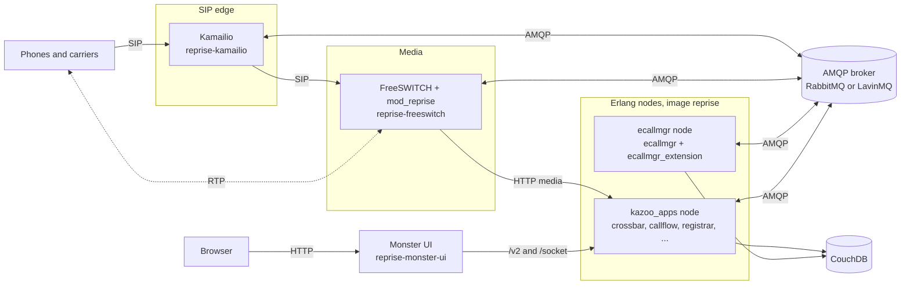

# Architecture

This page describes the parts of a Reprise cluster, what each does, and how
a registration and a call move through them. It assumes you know SIP,
FreeSWITCH and Kamailio, but not Kazoo. The last section lists what differs
from upstream Kazoo 5.4.

## The components

Every component except CouchDB and Monster UI talks to the others through
the AMQP broker. There is no Erlang node connection to FreeSWITCH and no
direct link between Kamailio and the Erlang nodes.

| Component | Role |
|---|---|
| Kamailio | SIP edge: registrar for devices (locations kept in its own `db_kazoo` SQLite database), digest authentication against Kazoo, NAT handling, presence, TLS and websockets, and load balancing of calls onto FreeSWITCH servers with the dispatcher. Configuration: `configs/kamailio`, installed as `/etc/kazoo/kamailio`. |
| FreeSWITCH with `mod_reprise` | Media server: SIP to Kamailio and carriers, RTP to phones, conferences, fax, recording, prompts. `mod_reprise` connects it to the broker, fetches its configuration and dialplan over AMQP, publishes call events and executes the commands ecallmgr sends. Configuration: `configs/freeswitch`, installed as `/etc/kazoo/freeswitch`. |
| AMQP broker | The bus. Kazoo uses topic, fanout and direct exchanges, exchange-to-exchange bindings and the `x-consistent-hash` exchange type; Erlang distribution uses the `amq.headers` exchange. See [configuration](configuration.md#the-amqp-broker). |
| ecallmgr node | Runs `ecallmgr`, which manages FreeSWITCH servers (call control, channel tracking, configuration and directory fetches, ACLs), and `ecallmgr_extension`, which implements the AMQP side of the `mod_reprise` transport. |
| kazoo_apps node | Runs the Kazoo applications listed below. Any number of these nodes can run, each with its own set of applications. |
| CouchDB | All persistent data: accounts, devices, users, callflows, media, CDRs, system configuration (`system_config`). |
| Monster UI | The web interface: static files served by nginx, which proxies `/v2/` to crossbar (the REST API) and `/socket` to blackhole (the websocket API). |

Both Erlang node types run from the same release and the same image; the
node name (`KAZOO_NODE`) and the application list (`KAZOO_APPS`) decide what
a node does. See [configuration](configuration.md#which-applications-a-node-runs).

## The applications

Each directory under `applications/` is one Erlang (or Gleam) application.
A node starts the applications named in `KAZOO_APPS`, or in its
`system_config/kapps_controller` settings, or the default list in
`core/kazoo_apps/src/kazoo_apps.hrl`. "Default" below means the application
is in that list.

| Application | Role |
|---|---|
| `blackhole` | Websocket API: streams Kazoo events (call, presence, ...) to clients such as Monster UI, on port 5555. Default. |
| `call_inspector` | Collects SIP and call data to help troubleshoot calls. |
| `callcenter` | Gleam. Call center queues, agents and their dispatchers ([guide](guides/callcenter.md)). Default. |
| `callflow` | Executes callflows: the per-account call routing trees (devices, users, voicemail, menus, ring groups, ...). Default. |
| `cdr` | Stores call detail records in CouchDB. Default. |
| `conference` | Conference service. Default. |
| `crossbar` | The REST API (`/v2/...`), on port 8000. Default. |
| `doodle` | SMS store-and-forward. |
| `ecallmgr` | FreeSWITCH resource and call control manager (runs on the ecallmgr node). |
| `ecallmgr_extension` | The AMQP transport to `mod_reprise` (runs next to `ecallmgr`; must be started explicitly). |
| `fax` | Fax sending and receiving, faxboxes, email-to-fax. Default. |
| `hangups` | Watches for abnormal hangups and records them. Default. |
| `hotornot` | Call rating by number prefix. |
| `jonny5` | Limits: stops accounts that exceed their call or channel limits. |
| `konami` | In-call metaflows: DTMF sequences mapped to features such as transfer or recording ([guide](guides/metaflows.md)). |
| `media_mgr` | Serves media (prompts, voicemail, music on hold) to FreeSWITCH over HTTP, on port 24517. Default. |
| `milliwatt` | Test tone and echo test numbers. Default. |
| `omnipresence` | Presence and BLF state. Default. |
| `pivot` | Hands call control to an external HTTP server that returns callflow instructions. Default. |
| `pusher` | Push notifications that wake mobile softphones for an incoming call. |
| `registrar` | Answers Kamailio's authentication requests for devices. Default. |
| `reorder` | Handles calls that nothing else routes. Default. |
| `skel` | A skeleton for writing new applications; not included in the release. |
| `stats` | Statistics collection and SNMP. |
| `stepswitch` | Offnet routing: places calls to carriers through the configured resources. Default. |
| `stir` | Gleam. STIR/SHAKEN keys, certificates, signing and verification ([guide](guides/stir-shaken.md)). |
| `sysconf` | Serves `system_config` to other components over AMQP. Default; started first. |
| `tasks` | Background tasks such as bulk imports. Default. |
| `teletype` | Notifications: emails for voicemail, faxes, account events. Default. |
| `trunkstore` | SIP trunking for PBXes. Default. |
| `webhooks` | Sends Kazoo events to customer HTTP endpoints. Default. |

## Life of a REGISTER

1. A phone sends REGISTER to Kamailio. Without credentials, Kamailio
   answers with a digest challenge.
2. With credentials, Kamailio publishes an `authn_req` (`Event-Category:
   directory`) to the `registrar` exchange and waits for the reply
   (`configs/kamailio/kamailio/registrar-role.cfg`).
3. The `registrar` application looks the device up by realm and username in
   the account database and answers with its credentials.
4. Kamailio checks the digest, saves the contact in its own location table
   (`save("location", ...)`, in the `db_kazoo` SQLite database), replies
   200, and publishes a `reg_success` event to the `registrar` exchange.
5. `ecallmgr` keeps a cache of these registrations, which the rest of the
   platform queries (for example to tell whether a device is registered).

The registration itself lives in Kamailio. When the platform later calls the
device, FreeSWITCH sends the INVITE to Kamailio with the address of record
in an `X-KAZOO-AOR` header, and Kamailio looks the contact up.

## Life of a call

A call from one registered device to another, in the default configuration:

1. The phone sends INVITE to Kamailio. Kamailio recognises a registered
   device by the address it registered from and adds the device's
   authorization token (`X-AUTH-Token`) without a challenge; any other
   caller is challenged and authenticated against Kazoo the same way as a
   REGISTER. Kamailio then picks a FreeSWITCH server with its dispatcher.
   The dispatcher list fills itself from the heartbeats the media servers
   publish on the broker; there are no static entries.
2. FreeSWITCH accepts the INVITE only if the sender's address is in the
   `authoritative` ACL that ecallmgr serves it (`sup ecallmgr_maintenance
   allow_sbc ...`, see [configuration](configuration.md#ecallmgr-acls)) and
   the request carries that token. A request Kamailio receives from one of
   its own addresses is passed on without a token and refused.
3. FreeSWITCH asks for a dialplan. `mod_reprise` turns the dialplan fetch
   into an AMQP message on the `freeswitch` exchange; through
   exchange-to-exchange bindings it reaches `ecallmgr_extension`, which
   publishes the route request (`route_req`) on the `callmgr` exchange.
   Route requests for one call always go to the same consumer because the
   exchanges in between are `x-consistent-hash` exchanges keyed on the
   call id.
4. Applications that can route the call answer (`callflow` for most calls,
   `trunkstore` for trunking accounts). ecallmgr chooses among the answers,
   and the winner is told it won (`route_win`) and takes control of the
   call.
5. `callflow` executes the account's callflow for the dialled number. Each
   step becomes a call-control command that ecallmgr forwards to
   FreeSWITCH through `mod_reprise` (bridge, play, record, ...). Call events
   come back the same way, on the `callevt` exchange.
6. To ring the other device, FreeSWITCH sends a new INVITE to Kamailio,
   which looks up the registered contact and forwards it. Media flows
   directly between each phone and FreeSWITCH; there is no RTP proxy.
7. FreeSWITCH fetches prompts and other media from `media_mgr` over HTTP
   (`http_cache://`, port 24517 on the kazoo_apps node; set
   `system_config/media.proxy_hostname` if the node's hostname is not
   reachable from FreeSWITCH).
8. When the call ends, FreeSWITCH publishes the CDR and the `cdr`
   application stores it in CouchDB.

## Erlang distribution over AMQP

The Erlang nodes do not use TCP to reach each other. The launcher
(`rel/kazoo`) starts each node with `-proto_dist kz amqp`:

- `amqp` is `vendor/amqp_dist`: Erlang distribution carried over the
  broker, using the `amq.headers` exchange. Nodes find each other through
  the broker configured in `config.ini` (`kazoo_apps_init:start_distribution/0`
  adds every configured AMQP URI), so nodes on different hosts form one
  Erlang cluster without opening distribution ports between them.
- `kz` is `core/kazoo_stdlib/src/kz_dist.erl`, plain TCP distribution that
  is only used for connecting to nodes named `freeswitch@...` (the old
  `mod_kazoo` node protocol, which Reprise does not use).

`rel/vm.args` pins the TCP distribution listener to `127.0.0.1`
(`inet_dist_use_interface`). What this means in practice:

- `sup`, the command-line tool for running maintenance functions, connects
  over local TCP distribution. Run it on the same host, or in the same
  container, as the node you want: `docker exec <container> sup ...`. It
  cannot reach a node on another host.
- Every node in a cluster must use the same Erlang cookie (`KAZOO_COOKIE`,
  or `cookie` in `config.ini`).
- If the broker is unavailable, the nodes lose their Erlang connections to
  each other as well as their AMQP traffic.

## Zones

Every node and media server belongs to a zone (default `local`): Kazoo
nodes from `KAZOO_ZONE` or the `zone` key of their `config.ini` section,
FreeSWITCH from `KZ_AMQP_ZONE`, Kamailio from the `MY_AMQP_ZONE` define
(set to `local` in `docker/kamailio/local.cfg.tpl`).
Zones let one platform span several sites with a broker per site. All three
images default to `local`, so a single-site cluster needs no zone
configuration.

## Differences from upstream Kazoo

What this tree changes relative to Kazoo 5.4 as 2600Hz shipped it:

- **FreeSWITCH transport.** Upstream ecallmgr controlled FreeSWITCH either
  through the open `mod_kazoo` Erlang node protocol or through 2600Hz's
  closed, commercially licensed `mod_com_kazoo` over AMQP.
  `freeswitch/mod_reprise` is an open implementation of the AMQP wire
  contract, written for Reprise and verified against `ecallmgr_extension`
  with `tools/fs-contract-probe`. The `reprise-freeswitch` image ships
  only `mod_reprise`: the entrypoint replaces the `mod_kazoo` load line in
  `modules.conf.xml`, and refuses any `KAZOO_TRANSPORT` other than `amqp`.
  The closed module's `dialog` and `live-events` relays are not
  implemented (nothing open consumes them). See
  [freeswitch/mod_reprise/README.md](../freeswitch/mod_reprise/README.md).
- **FreeSWITCH build.** FreeSWITCH v1.11.4 with seven patches
  (`docker/freeswitch/patches`) that add the session handoff, intercept,
  transfer, event and early-ringing behaviour ecallmgr expects from
  2600Hz's own FreeSWITCH build, plus one bridge ownership fix
  ([patches README](../docker/freeswitch/patches/README.md)).
- **Kamailio.** Built from the reprise-voice fork (2600Hz's patched core
  and its `kazoo` and `db_kazoo` modules, ported to Kamailio 6.1).
  `configs/kamailio` adds the files Kamailio 5.8 and 6.x need, and changes
  to presence authorization and subscription expiry
  ([configs/kamailio/README.md](../configs/kamailio/README.md)).
- **Erlang/OTP 28.** Upstream 5.4 targeted OTP 26. The core, ecallmgr,
  ecallmgr_extension, konami and amqp_dist carry the fixes OTP 28 needed,
  and the dependencies were moved to versions that build on it.
- **Gleam applications.** `callcenter` and `stir` are new, written in
  Gleam on `core/kazoo_gleam` and shipped in the same release.
  `callcenter` is in the default application list.
- **konami.** The in-call metaflow application from Kazoo 4.x, ported to
  5.x.
- **No telemetry.** `kazoo_telemetry` sent cluster metrics to a 2600Hz
  endpoint once a day; it and its `system_config` schemas are removed.
- **Broker compatibility.** Consistent-hash exchanges are declared with
  both `hash-header` (RabbitMQ) and `x-hash-on` (LavinMQ), and the call-id
  hash header is sent as a string, which LavinMQ requires.
- **Defaults.** New account realms default to `<random>.sip.example.com`
  (`system_config/crossbar.accounts.account_realm_suffix`), mobile devices
  to `mobile.example.com`, faxbox email to `fax.example.com`; the SIP
  User-Agent of FreeSWITCH, ecallmgr's sofia configuration and Kamailio is
  `Reprise`. Stored values are not changed.
- **Images.** Built from this tree, running as non-root users
  ([docker/README.md](../docker/README.md)).
- **Source repositories.** Every repository the build fetches is a fork
  under github.com/reprise-voice, at a pinned commit or tag
  (`make/repos.mk`).
